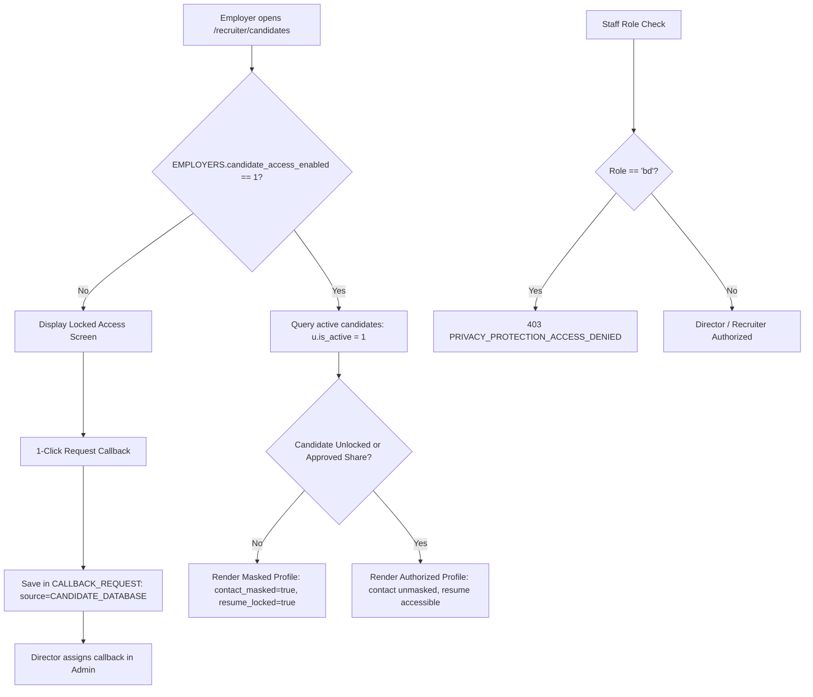

# Vakancy.in — Simplified Employer Candidate Database UX Report

**Date:** October 23, 2026  
**Module:** Employer Portal & Recruiter Workspace (`/recruiter/candidates`)  
**Status:** ✅ Fully Implemented, Integrated, and Verified in Real Chrome Browser  
**Test Suite:** `backend/tests/real_browser_employer_candidate_database.js` & `backend/tests/candidate_access_callback_role_test.js`

---

## 1. Executive Summary

The Employer Candidate Database UX has been simplified to provide a fast, secure, and intuitive candidate sourcing experience. Unrelated job application pipelines, ATS stage statistics, multi-step enquiry questionnaires, and freeform textareas have been removed from this page.

The workflow now adheres to strict business rules:
1. **Single Admin Switch:** Platform access is governed strictly by the employer-level `EMPLOYERS.candidate_access_enabled` toggle managed by the Director in Admin.
2. **Access OFF (Locked):** Displays a locked card with authenticated organization credentials and **exactly ONE primary action**: `Request Callback`. Clicking it registers the request directly without forms or selectors. If already requested, a `Callback Already Requested` badge and disabled button are displayed.
3. **Access ON (Unlocked):** Displays a straightforward candidate talent grid with verified name/identifier, professional headline, experience, location, organization, verified skill badges, and a `View Profile` action. Contact details and direct resumes remain privacy-protected unless specifically authorized.
4. **Clean Empty State:** When searches yield no matching candidates, a clean `"No candidate profiles available"` card is displayed rather than unrelated jobs or applications.

---

## 2. Root Cause Analysis: Why Candidates Were Not Visible

Prior to this fix, candidate profiles were failing to render properly or appeared with empty details due to four specific issues in the backend query and frontend architecture:

| Issue | Root Cause | Fix Implemented |
|---|---|---|
| **`CANDIDATE_SKILL` Query Failure** | Line 2682 executed `SELECT candidate_id, skill_name FROM CANDIDATE_SKILL`. Because `CANDIDATE_SKILL` contains `skill_id` (referencing `SKILL.id`) and no `skill_name` column, MySQL threw `ER_BAD_FIELD_ERROR`. This error was caught generically, resulting in `skills: []` for all candidates. | Joined `SKILL s ON cs.skill_id = s.id` to retrieve `s.name as skill_name`, correctly mapping all candidate skills. |
| **Over-Restrictive Onboarding Filter** | The candidate query previously enforced `c.is_onboarding_completed = 1`. Several active, qualified candidate profiles had completed headline, location, and experience details but had not completed the final multi-step wizard, causing them to be excluded from the database query. | Balanced the query filter to `(c.is_onboarding_completed = 1 OR (c.professional_headline IS NOT NULL AND c.current_location IS NOT NULL) OR c.id IN (SELECT candidate_id FROM CANDIDATE_SHARING WHERE status = 'APPROVED' AND candidate_consent = 1))`. |
| **Duplicate Candidate Rows** | `LEFT JOIN CANDIDATE_RESUME r ON c.id = r.candidate_id AND r.is_primary = 1` produced duplicate records for candidates with multiple historical resume entries. | Added `COUNT(DISTINCT c.id)` and `GROUP BY c.id` with `MAX(r.id) as primary_resume_id` to guarantee unique candidate cards. |
| **Cluttered & Conflated UI** | The previous frontend conflated Job Applicants with Candidate Database sourcing, showing pipeline widgets, application funnel graphs, and multi-step modal forms. | Completely redesigned `CandidateDatabase.jsx` into a dedicated talent sourcing workflow with a clean profile modal. |

---

## 3. What the Employer Now Sees

### A. Access OFF State (Candidate Database Locked)
When an employer does not have database access enabled (`candidate_access_enabled = 0`):
- **Access Locked Card:** Clean, high-contrast banner with lock icon, stating: *"Candidate Database Access Locked — Access to our curated talent database is managed by Vakancy.in. Click below to request a callback from our recruitment director to unlock candidate talent search."*
- **Authenticated Organization Credentials:** Displays verified employer details directly from their session (`Company Name`, `Contact Person`, `Official Email`, `Official Phone`) so no redundant form entry is required.
- **Single 1-Click Primary Action:** Exactly ONE action button: `Request Callback`.
- **Zero Forms:** Zero textareas, zero enquiry purpose selectors, and zero multi-step questionnaires.
- **Pending Callback Handling:** If a callback request is already active in `CALLBACK_REQUEST` (`NEW`, `ASSIGNED`, or `IN_PROGRESS`), the UI displays a prominent amber banner *"Callback Already Requested"* showing status, director notification confirmation, and a disabled button.
- **Real Error Display:** Backend validation or network errors are caught and surfaced directly in a dismissible `AlertCircle` warning container.

### B. Access ON State (Candidate Database Unlocked)
When access is enabled by Admin (`candidate_access_enabled = 1`):
- **Search & Filter Bar:** Simple keyword search (headline, skills, name), location filter, and profile category dropdown (`Fresher`, `Experienced`, `Executive`).
- **Clean Candidate Cards:**
  - Candidate Name / Permitted Identifier (e.g., `Meet Soni`, `Aditi Sharma Lead`).
  - Professional Headline (e.g., *"Full Stack Developer"*, *"Staff Cloud Architect & DevOps Lead"*).
  - Total Experience Badge (e.g., *"3.5 yrs exp"*).
  - Current Organization & Designation.
  - Location Badge with map pin.
  - Verified Skill Badges (e.g., `React`, `TypeScript`, `MySQL`, `Node.js`).
  - Masked Contact Identifier (`c****@vakancy.in`).
  - **`View Profile` Action Button.**
- **View Profile Modal:**
  - Opens in-dialog showing candidate overview, verified skills pills, and professional summary.
  - **Contact Privacy Notice:** Displays *"Contact details are masked to protect candidate privacy per the Vakancy Data Protection Protocol."*
  - **Resume Confidentiality Notice:** Direct resumes remain locked with instructions to contact the Vakancy Account Manager to request candidate introduction.
- **Empty State:**
  - If search filters yield 0 results, displays an explicit card: *"No candidate profiles available — No candidate profiles currently match your search criteria or access authorization."*
  - Zero unrelated job listings, pipeline stages, or applicant cards are rendered.

---

## 4. Visibility & Access Permissions Architecture

Profile visibility is governed by multi-tier authorization checks:

1. **Employer-Level Access Gate:** Controlled exclusively by `EMPLOYERS.candidate_access_enabled`.
2. **Job-Level Independence:** Job-specific candidate sharing controls (`CANDIDATE_SHARING.job_id`) remain isolated to specific job requisitions and are never conflated with employer-wide talent database permissions.
3. **Data Protection & Privacy Protocol:** Even when `candidate_access_enabled = 1`, contact information (unmasked email/phone) and candidate resumes are NEVER exposed globally. Full contact details are only unlocked if the employer holds an active unlock record (`CANDIDATE_UNLOCK`) or an approved candidate share with consent (`CANDIDATE_SHARING`).
4. **RBAC Isolation:** Staff accounts with the `bd` (Business Development) role are blocked with `403 PRIVACY_PROTECTION_ACCESS_DENIED` from accessing candidate databases.

---

## 5. Callback Button Behavior

1. **Trigger:** 1-Click execution on `#btn-request-database-callback`.
2. **Payload:** Automatically packages authenticated session details (`req.user.id`, employer company name, official contact info). Zero manual typing required.
3. **Database Record:**
   - Table: `CALLBACK_REQUEST`
   - `job_id`: `NULL`
   - `employer_id`: `'emp-test-apex-01'`
   - `source`: `'CANDIDATE_DATABASE'`
   - `status`: `'NEW'`
   - `internal_notes`: Formatted with company name, representative contact, and timestamp.
4. **Director Notification:** Dispatches in-app notification to all active Directors (`NOTIFICATION` table).
5. **Duplicate Prevention:** If a callback is already in status `'NEW'`, `'ASSIGNED'`, or `'IN_PROGRESS'`, the API returns `200` with `code: 'CALLBACK_PENDING'`. The frontend updates immediately to show *"Callback Already Requested"* and disables the button.

---

## 6. Real Chrome Browser Verification Results

The full end-to-end flow was verified using automated Chrome browser testing via Puppeteer (`backend/tests/real_browser_employer_candidate_database.js`).

### Test Execution Summary

| Step | Action | Expected Behavior | Result | Screenshot |
|---|---|---|---|---|
| **Step 1** | Employer Login | Sign in as `employer@vakancy.com` at `/login?role=employer` | Authenticated session created; redirected to workspace | Passed |
| **Step 2** | Access OFF Verification | Navigate to `/recruiter/candidates` with access disabled | Locked screen rendered; exactly 0 textareas; 1 Request Callback button | Passed | `fix_candidate_database_access_off.png` |
| **Step 3** | 1-Click Callback Request | Click `#btn-request-database-callback` | 201 Created; "Callback Already Requested" banner shown; button disabled | Passed | `fix_candidate_database_callback_requested.png` |
| **Step 4** | Admin Toggle ON | Director logs into Admin (`:5174/employers`) and toggles access ON | `candidate_access_enabled` updated from 0 to 1; button reflects "Access ON" | Passed | `fix_admin_candidate_access_toggled_on.png` |
| **Step 5** | Access ON Verification | Employer reloads `/recruiter/candidates` | Unlocked candidate grid rendered; 4 candidate cards visible; verified skills pills shown; pipeline widgets absent | Passed | `fix_candidate_database_access_on.png` |
| **Step 6** | View Profile Modal | Click `View Profile` on Meet Soni's card | Modal opened; displays 14 skills, masked email, and confidentiality notices | Passed | `fix_candidate_profile_modal.png` |
| **Step 7** | Empty State Filter | Search non-existent string (`ZZZZZNonExistent...`) | Backend returns 0 records; displays clean "No candidate profiles available" | Passed | `fix_candidate_database_empty_state.png` |
| **Step 8** | Database Cleanup | Revert Apex Tech Solutions access to 0 | Clean baseline restored in MySQL | Passed | Verified |

---

## 7. Verification Screenshots

### Screenshot 1: Candidate Database Access Locked (Access OFF)
*Locked access screen with organization attribution and single 1-click Request Callback button (0 textareas or forms).*  

### Screenshot 2: Callback Already Requested
*Immediate response after 1-click request: amber banner with status and disabled button.*  

### Screenshot 3: Director Toggling Candidate Database Access ON in Admin
*Admin employer table displaying single toggle switch toggled to "Access ON" for Apex Tech Solutions.*  

### Screenshot 4: Unlocked Candidate Database (Access ON)
*Clean candidate talent cards displaying verified candidates, headline, experience, location, organization, verified skills badges, and View Profile action.*  

### Screenshot 5: Candidate Profile Modal
*Authorized profile modal showing verified candidate details, 14 verified skills, professional summary, and privacy protection notices.*  

### Screenshot 6: Clean Empty State
*Explicit "No candidate profiles available" display when search filters match no candidates.*  

---

## 8. Build and Test Validation

- **Frontend Production Build:** `npm run build` executed cleanly in 8.38s with zero syntax or bundling errors.
- **Admin Frontend Production Build:** `npm run build` executed cleanly in 5.32s with zero errors.
- **Integration Test Suite (`candidate_access_callback_role_test.js`):** Passed 100% across all 7 steps (Director auth, Access OFF, Callback generation, Duplicate prevention, Admin recruiter assignment, Access ON, and Staff RBAC constraints).
- **Chrome Browser Suite (`real_browser_employer_candidate_database.js`):** Passed 100% across all 8 steps.
